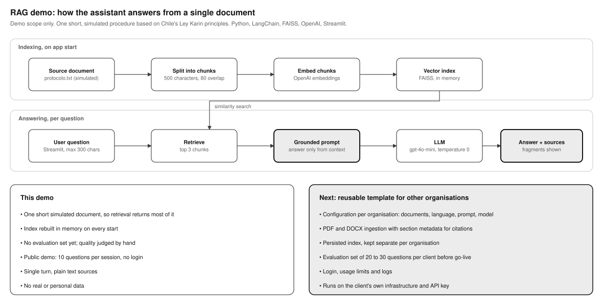

# AI-Powered Legal Assistant
RAG prototype for case-based decision support

> **Demo / proof of concept.** This is a learning prototype built on one short, simulated
> procedure. It shows the RAG pattern end to end (chunking, retrieval, grounded answers with
> sources); it is not a production system and holds no real data.

## Architecture (demo scope)

## Live Demo
https://ai-document-assistant0.streamlit.app/

---
## Application Preview

### 1. Complaint Data Requirements

The system helps users identify the information needed to properly structure a workplace complaint.

---

### 2. Investigation Decision Support

The assistant guides users on whether a case should be handled internally or escalated to the Labour Authority, based on the procedure in the source document.

---

### 3. Complex Case Handling

The assistant addresses non-standard scenarios, such as cases involving individuals outside the organisation.

---

## Project Overview

This project is a **proof-of-concept** that turns a static procedural document into an
interactive question-answering assistant using a Retrieval-Augmented Generation (RAG)
architecture.

It was inspired by a real-world scenario: organisations that manage case-based processes
(e.g. workplace complaints) rely heavily on documents and expert interpretation, which makes
information slow to find and decisions inconsistent.

To ensure confidentiality, the source document used here is **simulated**, based on the
principles of Chile's Ley Karin (Law 21.643).

---

## Business Problem

Organisations managing sensitive, document-heavy processes often face:

- Knowledge fragmented across documents
- Time-consuming manual search
- High reliance on expert interpretation
- Risk of inconsistent decisions

---

## What This Prototype Does

- Accepts natural-language questions about the procedure
- Retrieves the most relevant sections of the document
- Generates an answer **grounded only in the retrieved content**
- Shows the exact document fragments used to produce each answer (traceability)

---

## How It Works (RAG architecture)

1. **Load** the source document
2. **Chunk** it into smaller overlapping fragments (`RecursiveCharacterTextSplitter`)
3. **Embed** each fragment and index it in a FAISS vector store
4. **Retrieve** the top fragments most relevant to the user's question
5. **Generate** an answer constrained to that retrieved context (grounding prompt),
   and return the source fragments used

This grounding step is what keeps the assistant from inventing answers: if the information
is not in the document, the assistant says so.

---

## Technology Stack

- Python
- Streamlit
- LangChain
- OpenAI API (embeddings + LLM)
- FAISS (vector store)

---

## Limitations (honest scope of this prototype)

- Single-document knowledge base (one simulated procedure). The document is short enough that
  retrieval returns most of it; the pattern only pays off with a larger, multi-document corpus
- Answers are limited to the content of that document
- No formal evaluation metrics on answer quality yet
- Not a replacement for professional or legal advice
- No real-time or multi-source data integration
- The index is built in memory on each app start (not persisted)
- Public demo limits: 10 questions per session, 300 characters per question

This is a focused MVP, not a production system. The points below are the natural next steps.

---

## Next Steps (roadmap to a reusable template)

- Configuration per organisation (documents, language, prompt, model) with no code changes
- Multi-document knowledge base with PDF and DOCX ingestion and section metadata
- Persisted index, kept separate per organisation
- Evaluation harness to measure answer quality (faithfulness / relevance)
- Inline citations linking each claim to its source fragment
- Role-based access control
- Admin interface for managing the knowledge base

---

## Business Analyst Perspective

This project reflects core Business Analyst capabilities:

- Identifying a real business problem in a document-heavy process
- Translating an unstructured procedure into inputs, decision points and outputs
- Designing a solution aligned to the business need
- Delivering a working MVP and being explicit about its scope and limitations
- Bridging business needs and technical implementation
